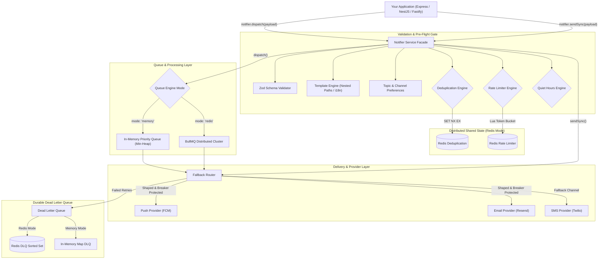
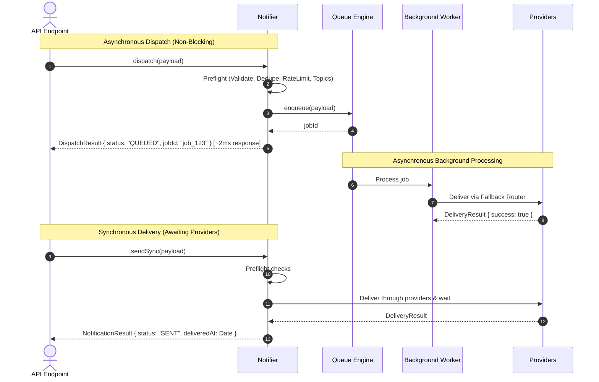
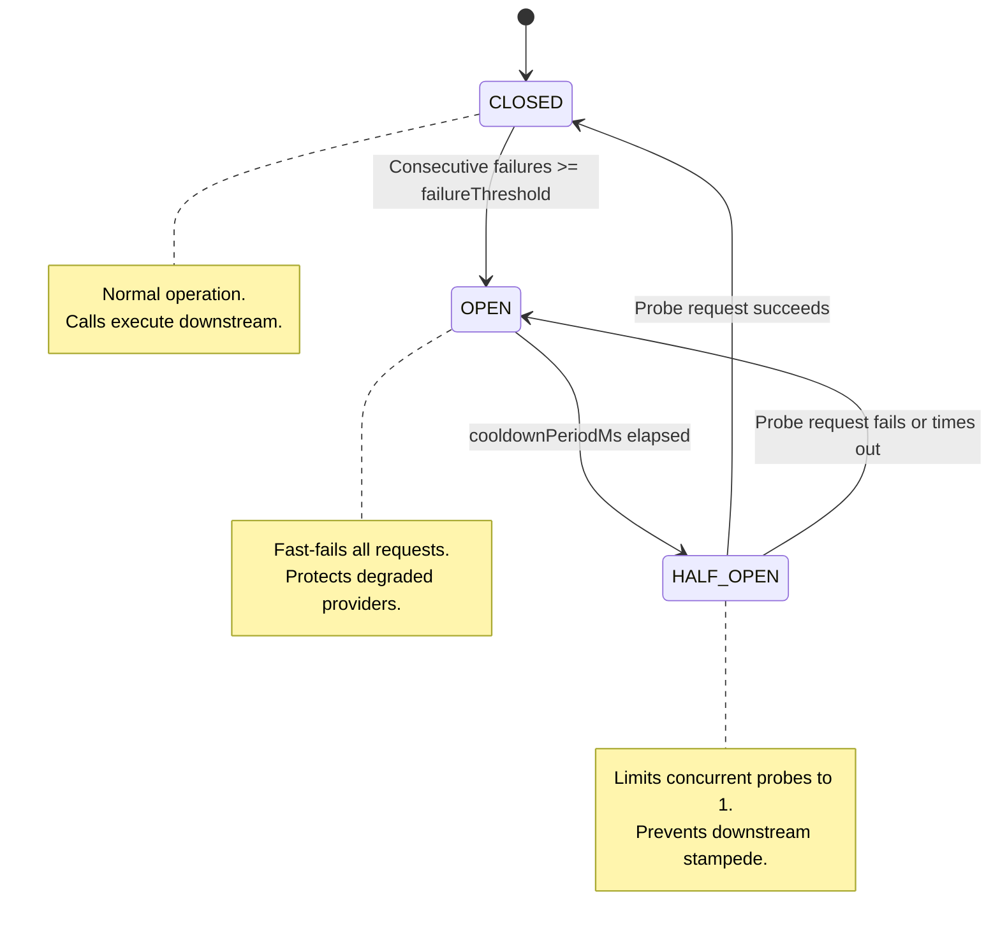
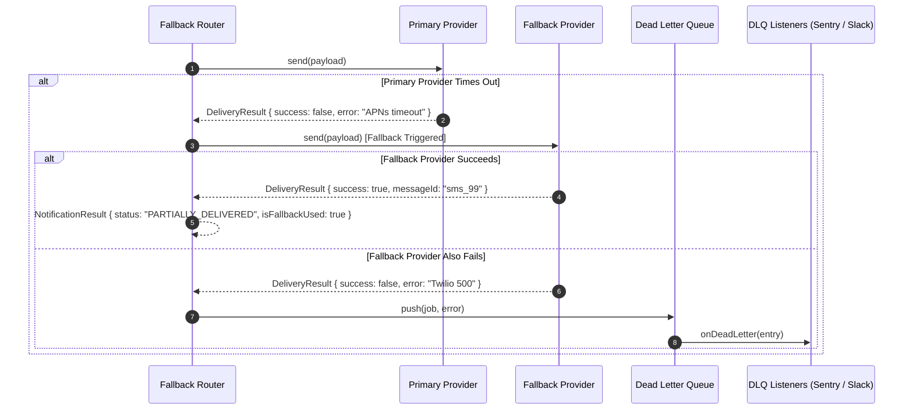
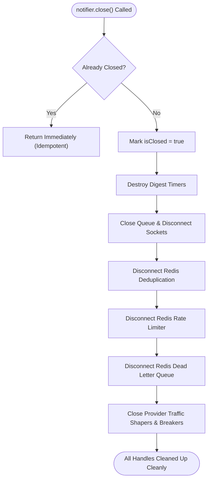

# 📦 distributed-notifier

[](https://www.npmjs.com/package/distributed-notifier)
[](https://www.typescriptlang.org/)
[](LICENSE)
[]()
[]()
[](https://github.com/rakiburrahman307/distributed-notifier/actions)

**A production-grade, distributed notification engine engineered for high-throughput, fault-tolerant delivery across Push (FCM/APNs), In-App WebSockets, Email, SMS, and Webhooks.**

---

## 📑 Table of Contents

1. [Package Overview](#1-package-overview)
2. [Key Architectural Highlights](#2-key-architectural-highlights)
3. [Technology Stack](#3-technology-stack)
4. [Folder Structure](#4-folder-structure)
5. [Architecture & Flow Diagrams](#5-architecture--flow-diagrams)
   - [5.1 High-Level Distributed Architecture](#51-high-level-distributed-architecture)
   - [5.2 Asynchronous Dispatch vs Synchronous Delivery](#52-asynchronous-dispatch-vs-synchronous-delivery)
   - [5.3 Notification Lifecycle Flow](#53-notification-lifecycle-flow)
   - [5.4 Circuit Breaker State Machine](#54-circuit-breaker-state-machine)
   - [5.5 Retry, Fallback & Dead Letter Queue (DLQ)](#55-retry-fallback--dead-letter-queue-dlq)
   - [5.6 Graceful Shutdown & Resource Lifecycle](#56-graceful-shutdown--resource-lifecycle)
6. [Modes of Operation](#6-modes-of-operation)
   - [In-Memory Mode (Zero-Infrastructure)](#in-memory-mode-zero-infrastructure)
   - [Distributed Mode (True Redis Shared State)](#distributed-mode-true-redis-shared-state)
7. [Installation & Configuration](#7-installation--configuration)
8. [Complete Usage Examples](#8-complete-usage-examples)
   - [8.1 Asynchronous Background Dispatch (`dispatch`)](#81-asynchronous-background-dispatch-dispatch)
   - [8.2 Direct Synchronous Delivery (`sendSync`)](#82-direct-synchronous-delivery-sendsync)
   - [8.3 Category & Topic Preferences (Opt-Out with Security Override)](#83-category--topic-preferences-opt-out-with-security-override)
   - [8.4 Advanced Template Engine (Nested Paths, Conditionals, i18n)](#84-advanced-template-engine-nested-paths-conditionals-i18n)
   - [8.5 Provider Traffic Shaping & Backpressure](#85-provider-traffic-shaping--backpressure)
   - [8.6 Durable Dead Letter Queue (DLQ) Inspection](#86-durable-dead-letter-queue-dlq-inspection)
   - [8.7 Bounded Bulk Delivery (`sendBulk`)](#87-bounded-bulk-delivery-sendbulk)
   - [8.8 Built-in Webhook Delivery (Slack, Discord, Custom APIs)](#88-built-in-webhook-delivery-slack-discord-custom-apis)
   - [8.9 Observability & Lifecycle Event Hooks (`EventEmitter`)](#89-observability--lifecycle-event-hooks-eventemitter)
9. [Adding Custom Providers](#9-adding-custom-providers)
10. [Resource Safety & Memory Guarantees](#10-resource-safety--memory-guarantees)
11. [Testing & Verification](#11-testing--verification)
12. [License](#12-license)

---

## 1. Package Overview

Sending notifications in distributed environments involves critical challenges: third-party provider timeouts (APNs/FCM), duplicate deliveries during network retries, spamming users during quiet hours, cross-server race conditions in cluster deployments, and thread exhaustion when downstream HTTP APIs degrade.

`distributed-notifier` is engineered as a complete, self-contained notification engine that can run in:
* **Zero-Dependency In-Memory Mode**: Using a Binary Min-Heap $O(\log N)$ priority scheduler, token bucket rate limiter, and sliding-window deduplication for local development and single-server apps.
* **True Distributed Redis Mode**: Powered by BullMQ background workers, atomic Redis `SET NX EX` deduplication, atomic Redis Lua script token buckets, and persistent Redis Dead Letter Queues for multi-instance horizontal scaling.

---

## 2. Key Architectural Highlights

* **Immediate Dispatch vs Synchronous Send**:
  * `notifier.dispatch(payload)`: Sub-millisecond enqueue returning a stable `jobId` for instant HTTP API responses.
  * `notifier.sendSync(payload)`: Awaits direct third-party provider delivery with full multi-channel fallback trace.
* **True Distributed State in Redis Mode**:
  * Cross-node Idempotency (`RedisDeduplicationEngine`) via atomic `SET key 1 NX EX <ttl>`.
  * Cluster-wide Token Bucket Rate Limiting (`RedisTokenBucketRateLimiter`) via atomic Redis Lua script.
  * Durable Dead Letter Queue (`RedisDeadLetterQueue`) indexed by Sorted Set with automatic bounded trimming.
* **Provider Traffic Shaper (Leaky Bucket)**:
  * Integrated directly into `BaseProvider` to smooth burst traffic and eliminate HTTP 429 Too Many Requests errors.
  * Backpressure capacity limits prevent memory leaks during extended downstream outages.
* **Leak-Free Circuit Breaker**:
  * Guaranteed timer cleanup in `Promise.race()` prevents lingering Node.js timer handles.
  * Concurrency guard on `HALF_OPEN` state prevents test probe stampedes.
* **Advanced Template Engine**:
  * Nested object paths (`{{user.profile.name}}`, `{{order.items.0.price}}`).
  * Conditionals (`{{#if isVip}}VIP Special{{else}}Standard{{/if}}`).
  * Multi-language localization (i18n) with automatic locale fallback.
  * Safe HTML escaping with optional raw `{{{var}}}` injection.
* **Category & Topic Subscriptions**:
  * Recipient opt-out preferences per topic (e.g., disable `marketing` while keeping `security` and `transactional`).
* **AWS-Standard Full Jitter Backoff**:
  * Eliminates the Thundering Herd Problem across distributed retries.
* **Vectorized Multicast Push**:
  * Chunks device tokens into batches of 500 (FCM standard) for 95% reduced network roundtrips.

---

## 3. Technology Stack

| Layer | Technology | Role & Purpose |
| :--- | :--- | :--- |
| **Language** | **TypeScript 5 (Strict)** | Strict types, declaration maps, and interface contracts. |
| **Validation** | **Zod** | Pre-flight payload validation at public boundaries. |
| **In-Memory Queue** | **Binary Min-Heap ($O(\log N)$)** | High-throughput priority scheduling without linear scan overhead. |
| **Distributed Queue** | **BullMQ & ioredis** | Multi-node cluster background job queue and retry pipeline. |
| **Rate Limiter** | **Token Bucket (In-Memory & Redis Lua)** | Per-recipient anti-spam and provider rate limiting. |
| **Resilience** | **Circuit Breaker & Leaky Bucket Shaper** | Downstream fault-tolerance and egress throttling. |
| **Testing** | **Node.js Native Test Runner (`--test`)** | Fast, zero-dependency test runner with `--test-force-exit`. |

---

## 4. Folder Structure

```text
packages/distributed-notifier/
├── src/
│   ├── types/
│   │   ├── notification.ts     # Recipient, Payload, Channel, Result & Dispatch interfaces
│   │   ├── provider.ts         # IProvider contract & MulticastResult
│   │   ├── queue.ts            # IQueueEngine, Job, and RetryPolicy
│   │   └── config.ts           # NotifierConfig and connection options
│   ├── validations/
│   │   └── schemas.ts          # Zod validation schemas
│   ├── engines/
│   │   ├── queue/
│   │   │   ├── in-memory-queue.ts  # Min-Heap priority queue with backpressure
│   │   │   └── bullmq-queue.ts     # BullMQ distributed queue adapter
│   │   ├── deduplication.ts        # InMemory & RedisDeduplicationEngine
│   │   ├── rate-limiter.ts         # InMemory & RedisTokenBucketRateLimiter
│   │   ├── template-engine.ts      # Nested paths, conditionals & i18n renderer
│   │   ├── quiet-hours.ts          # Timezone-aware quiet hours engine
│   │   ├── digest-engine.ts        # Micro-event batching & flush aggregation
│   │   ├── dead-letter-queue.ts    # InMemory & durable RedisDeadLetterQueue
│   │   └── traffic-shaper.ts       # Leaky Bucket Provider Traffic Shaper
│   ├── providers/
│   │   ├── base.provider.ts        # Abstract BaseProvider with circuit breaker & shaper
│   │   ├── push.provider.ts        # Push adapter (FCM / APNs) with multicast
│   │   ├── socket.provider.ts      # WebSocket / Socket.io adapter
│   │   ├── email.provider.ts       # Email adapter
│   │   ├── sms.provider.ts         # SMS adapter
│   │   └── mock.provider.ts        # Mock provider for testing
│   ├── services/
│   │   ├── fallback-router.ts      # Multi-channel delivery and fallback router
│   │   └── notifier.service.ts     # Main Orchestrator Facade (Notifier)
│   ├── utils/
│   │   ├── circuit-breaker.ts      # Memory-safe circuit breaker
│   │   ├── min-heap.ts             # Binary Min-Heap data structure
│   │   ├── backoff.ts              # Full Jitter Exponential Backoff algorithm
│   │   └── logger.ts               # Structured logger
│   └── index.ts                    # Public API exports
├── tests/
│   ├── circuit-breaker.test.ts     # Circuit breaker resilience & timer tests
│   ├── dispatch-async.test.ts      # Async dispatch & topic preference tests
│   ├── min-heap.test.ts            # Min-Heap algorithmic tests
│   ├── multicast.test.ts           # Push multicast batching tests
│   ├── notifier.test.ts            # Core integration tests
│   ├── provider-traffic-shaping.test.ts # Provider traffic shaping tests
│   ├── quiet-hours.test.ts         # Quiet hours unit tests
│   ├── rate-limiter.test.ts        # Rate limiter unit tests
│   ├── redis-distributed.test.ts   # Real Redis concurrency & BullMQ integration tests
│   ├── stress-lifecycle.test.ts    # 1,000 notifications heap & shutdown tests
│   ├── template-advanced.test.ts   # Advanced template engine tests
│   └── traffic-shaper.test.ts      # Traffic shaper unit tests
├── package.json
├── tsconfig.json
└── README.md
```

---

## 5. Architecture & Flow Diagrams

### 5.1 High-Level Distributed Architecture



---

### 5.2 Asynchronous Dispatch vs Synchronous Delivery



---

### 5.3 Notification Lifecycle Flow

```mermaid
flowchart TD
    Start(["Notification Request"]) --> Validate{"Zod Validation Pass?"}
    Validate -->|No| ThrowErr["Throw ValidationError"]
    Validate -->|Yes| CheckTopic{"Recipient Subscribed to Topic?"}

    CheckTopic -->|Opted Out & Not Critical| SuppressTopic["Return status: UNSUBSCRIBED"]
    CheckTopic -->|Subscribed or High Priority| CheckDedupe{"Idempotency Key Exists?"}

    CheckDedupe -->|Duplicate| RetDupe["Return status: SKIPPED_DUPLICATE"]
    CheckDedupe -->|New Key| CheckRate{"Rate Limit Tokens Available?"}

    CheckRate -->|Exceeded| RetRate["Return status: RATE_LIMITED"]
    CheckRate -->|Allowed| CheckQuiet{"Recipient Quiet Hours Active?"}

    CheckQuiet -->|Yes & Not High Priority| SchedDelay["Schedule at wake-up time"]
    CheckQuiet -->|No or Urgent OTP| CheckAsync{"Async Dispatch or Sync Send?"}

    CheckAsync -->|dispatch()| PushQueue["Enqueue in Queue & Return QUEUED"]
    CheckAsync -->|sendSync()| ExecDelivery["Execute Fallback Router"]

    ExecDelivery --> DeliverySuccess{"Delivery Succeeded?"}
    DeliverySuccess -->|Yes| DoneSent["Return status: SENT"]
    DeliverySuccess -->|Primary Failed| CheckFallback{"Fallback Channels Configured?"}
    CheckFallback -->|Yes| ExecFallback["Attempt Fallback Provider"]
    CheckFallback -->|No| PushDLQ["Push to Dead Letter Queue (DLQ)"]
    ExecFallback --> FallbackSuccess{"Fallback Succeeded?"}
    FallbackSuccess -->|Yes| DonePartial["Return status: PARTIALLY_DELIVERED"]
    FallbackSuccess -->|No| PushDLQ
```

---

### 5.4 Circuit Breaker State Machine



---

### 5.5 Retry, Fallback & Dead Letter Queue (DLQ)



---

### 5.6 Graceful Shutdown & Resource Lifecycle



---

## 6. Modes of Operation

### In-Memory Mode (Zero-Infrastructure)
* **Zero External Dependencies**: Runs entirely inside the Node.js process.
* **$O(\log N)$ Priority Min-Heap**: Sub-millisecond queue scheduling without array sorting bottlenecks.
* **Bounded Maps**: Internal caches feature maximum capacity bounds with LRU/FIFO eviction to eliminate unbounded memory growth.
* **Best For**: Development, local testing, continuous integration (CI), and single-instance backend servers.

### Distributed Mode (True Redis Shared State)
* **BullMQ Distributed Queue**: Multiple instances process jobs from shared Redis queues.
* **Atomic Cross-Instance Deduplication**: Prevents duplicate deliveries even when parallel requests hit separate servers.
* **Atomic Distributed Rate Limiting**: Shared token bucket via Redis Lua scripts protects against distributed spam.
* **Durable Dead Letter Queue**: Failed notifications persist across server restarts and deployments.
* **Best For**: Multi-node Kubernetes clusters, serverless environments, and high-throughput production microservices.

---

## 7. Installation & Configuration

```bash
# Core package (Zero dependencies)
npm install distributed-notifier zod

# Optional: For distributed Redis mode
npm install bullmq ioredis
```

---

## 8. Complete Usage Examples

### 8.1 Asynchronous Background Dispatch (`dispatch`)

Use `dispatch()` in web handlers (Express/NestJS) for instant responses:

```typescript
import { Notifier, PushProvider } from 'distributed-notifier';

const notifier = new Notifier({
  mode: 'redis',
  redis: process.env.REDIS_URL || 'redis://localhost:6379',
  providers: [
    new PushProvider({
      name: 'fcm-main',
      sender: async (tokens, notification) => {
        // Integrate with firebase-admin
        return { success: true, messageId: 'fcm_msg_101' };
      },
    }),
  ],
});

// Fast non-blocking enqueue (~2ms)
const ack = await notifier.dispatch({
  id: 'order_assigned_1001',
  idempotencyKey: 'idemp_order_1001',
  recipient: {
    id: 'user_42',
    pushTokens: ['fcm_token_xyz'],
  },
  channels: ['push'],
  title: 'Driver Assigned',
  body: 'Your driver is on the way!',
});

console.log(ack.status); // "QUEUED"
console.log(ack.jobId);  // "order_assigned_1001"
```

---

### 8.2 Direct Synchronous Delivery (`sendSync`)

Use `sendSync()` when the caller requires immediate delivery results:

```typescript
const result = await notifier.sendSync({
  id: 'otp_verification',
  recipient: {
    id: 'user_99',
    phone: '+8801700000000',
    pushTokens: ['token_abc'],
  },
  channels: ['push'],
  fallbackChannels: ['sms'], // Automatically falls back to SMS if Push fails
  priority: 'HIGH',          // Bypasses quiet hours
  title: 'Verification Code',
  body: 'Your OTP is 849201',
});

console.log(result.status);         // "SENT" or "PARTIALLY_DELIVERED"
console.log(result.isFallbackUsed); // true if delivered via SMS
```

---

### 8.3 Category & Topic Preferences (Opt-Out with Security Override)

```typescript
// Recipient opted out of 'marketing', but kept 'security'
const payload = {
  id: 'promo_spring_sale',
  topic: 'marketing',
  recipient: {
    id: 'user_77',
    preferences: {
      topics: {
        marketing: false, // User unsubscribed
        security: true,
      },
    },
  },
  channels: ['push', 'email'],
  title: 'Spring Sale 50% Off',
};

const result = await notifier.sendSync(payload);
console.log(result.status); // "UNSUBSCRIBED" (Suppressed safely)

// Critical notifications with priority: 'HIGH' bypass opt-out:
const criticalAlert = {
  id: 'sec_alert_1',
  topic: 'security',
  priority: 'HIGH',
  recipient: payload.recipient,
  channels: ['email'],
  title: 'Unauthorized Login Attempt',
};

const alertResult = await notifier.sendSync(criticalAlert);
console.log(alertResult.status); // "SENT"
```

---

### 8.4 Advanced Template Engine (Nested Paths, Conditionals, i18n)

```typescript
notifier.registerTemplate({
  id: 'trip_receipt',
  defaultLocale: 'en',
  title: 'Trip #{{trip.id}} Receipt',
  body: 'Hello {{user.profile.name}}, your fare was ${{trip.fare.total}}. {{#if isVip}}Thank you for being a VIP!{{else}}Join VIP for 10% off!{{/if}}',
  locales: {
    bn: {
      title: 'ট্রিপ #{{trip.id}} রসিদ',
      body: 'হ্যালো {{user.profile.name}}, আপনার ভাড়া ${{trip.fare.total}}। {{#if isVip}}ভিআইপি হওয়ার জন্য ধন্যবাদ!{{else}}১০% ছাড়ের জন্য ভিআইপিতে যোগ দিন!{{/if}}',
    },
  },
});

// Render in Bengali:
const res = await notifier.sendSync({
  id: 'receipt_1',
  templateId: 'trip_receipt',
  locale: 'bn',
  recipient: { id: 'u_1', pushTokens: ['tok_1'] },
  channels: ['push'],
  variables: {
    user: { profile: { name: 'রাকিবুর' } },
    trip: { id: 'TRIP_88', fare: { total: 250 } },
    isVip: true,
  },
});
```

---

### 8.5 Provider Traffic Shaping & Backpressure

Protect third-party providers (SendGrid, Twilio, FCM) from rate-limit throttling:

```typescript
import { PushProvider } from 'distributed-notifier';

const rateLimitedPush = new PushProvider({
  name: 'fcm-metered',
  trafficShaperOptions: {
    maxRequestsPerSecond: 25, // Leaky Bucket pacing: 1 request every 40ms
    maxQueueSize: 500,        // Backpressure limit
  },
  circuitBreakerOptions: {
    failureThreshold: 5,      // Trip OPEN after 5 consecutive failures
    cooldownPeriodMs: 15000,  // Test recovery after 15s
    timeoutMs: 5000,          // 5s request timeout with automatic timer cleanup
  },
});

notifier.registerProvider(rateLimitedPush);
```

---

### 8.6 Durable Dead Letter Queue (DLQ) Inspection

```typescript
const dlq = notifier.getDeadLetterQueue();

// Register alert webhook (e.g. Slack / Sentry)
dlq.onDeadLetter(async (entry) => {
  console.error(`Alert: Job ${entry.job.id} failed permanently:`, entry.error.message);
});

// Query failed entries
const totalFailed = await dlq.count();
const recentFailures = await dlq.getAll(10);
```

---

### 8.7 Bounded Bulk Delivery (`sendBulk`)

```typescript
const bulkPayloads = users.map((u) => ({
  id: `blast_${u.id}`,
  recipient: { id: u.id, email: u.email },
  channels: ['email'],
  title: 'System Maintenance Notice',
}));

// Dispatches with controlled parallel pool of 10 workers
const results = await notifier.sendBulk(bulkPayloads, { concurrency: 10, async: true });
```

---

### 8.8 Built-in Webhook Delivery (Slack, Discord, Custom APIs)

The built-in `WebhookProvider` delivers structured JSON payloads directly over HTTP/HTTPS with automatic timeout safety and custom headers:

```typescript
import { Notifier, WebhookProvider } from 'distributed-notifier';

const notifier = new Notifier();

// Register generic or channel-specific webhook provider
const slackWebhook = new WebhookProvider({
  name: 'slack-ops',
  headers: { Authorization: 'Bearer xoxb-...' },
  timeoutMs: 5000,
});

notifier.registerProvider(slackWebhook);

// Dispatch notification with dynamic target URL
await notifier.dispatch({
  id: 'deploy_notice_1',
  recipient: { id: 'devops-team' },
  channels: ['webhook'],
  title: 'Production Deployment Succeeded',
  body: 'Release v1.2.0 is live across all cluster nodes',
  metadata: {
    webhookUrl: 'https://hooks.slack.com/services/T00/B00/XXXX',
  },
});
```

---

### 8.9 Observability & Lifecycle Event Hooks (`EventEmitter`)

`Notifier` extends Node.js `EventEmitter` with fully-typed lifecycle hooks. Easily stream events to Datadog, Prometheus, Slack alerts, or database audit trails without modifying core business logic:

```typescript
import { Notifier } from 'distributed-notifier';

const notifier = new Notifier();

// 1. Audit trail for every queued or suppressed job
notifier.on('dispatched', (result, payload) => {
  console.log(`[DISPATCHED] Job ${result.jobId} -> Status: ${result.status}`);
});

// 2. Metrics for successful third-party provider delivery
notifier.on('delivered', (result, payload) => {
  statsd.increment('notifications.delivered', { channels: result.channelsAttempted });
});

// 3. Automated alerting on delivery failure
notifier.on('failed', (result, payload) => {
  console.error(`[ALERT] Notification ${payload.id} delivery failed:`, result.channelResults);
});

// 4. Opt-out and suppression telemetry
notifier.on('suppressed', ({ reason, payload }) => {
  console.warn(`[SUPPRESSED] Notification ${payload.id} skipped due to ${reason}`);
});

// 5. Permanent dead-letter tracking
notifier.on('dead_letter', (entry) => {
  pagerDuty.trigger({ message: entry.error.message, payload: entry.job.payload });
});
```

---

## 9. Adding Custom Providers

Implement custom channels by subclassing `BaseProvider`:

```typescript
import { BaseProvider, ChannelDeliveryResult, NotificationPayload } from 'distributed-notifier';

export class DiscordWebhookProvider extends BaseProvider {
  public readonly name = 'discord-notifier';
  public readonly channel = 'webhook' as const;

  constructor(private readonly webhookUrl: string) {
    super({
      trafficShaperOptions: { maxRequestsPerSecond: 5 },
      circuitBreakerOptions: { failureThreshold: 3, timeoutMs: 4000 },
    });
  }

  protected async deliver(payload: NotificationPayload): Promise<ChannelDeliveryResult> {
    const res = await fetch(this.webhookUrl, {
      method: 'POST',
      headers: { 'Content-Type': 'application/json' },
      body: JSON.stringify({ content: `**${payload.title}**: ${payload.body}` }),
    });

    if (!res.ok) {
      return {
        success: false,
        channel: 'webhook',
        provider: this.name,
        error: `Discord responded with status ${res.status}`,
        timestamp: Date.now(),
      };
    }

    return {
      success: true,
      channel: 'webhook',
      provider: this.name,
      messageId: `discord_${Date.now()}`,
      timestamp: Date.now(),
    };
  }
}

notifier.registerProvider(new DiscordWebhookProvider(process.env.DISCORD_URL!));
```

---

## 10. Resource Safety & Memory Guarantees

* **Zero Circuit Breaker Timer Leaks**: Timeout promises explicitly clear their scheduled timer via a `finally` block on every resolution, rejection, or timeout event.
* **Deterministic HALF_OPEN Probe Concurrency**: Exactly one probe is permitted to test downstream health in `HALF_OPEN` state, preventing concurrent test storms.
* **Bounded In-Memory Stores**: All internal maps (`Deduplication`, `RateLimiter`, `DeadLetterQueue`, `Queue`) enforce hard item caps with automatic eviction.
* **Graceful & Idempotent Shutdown**: Calling `notifier.close()` safely disposes all timers, drains queue workers, cleanly disconnects Redis sockets, and releases provider resources.

---

## 11. Testing & Verification

Run the complete test suite:

```bash
# Run unit, integration, concurrency, and stress tests
npm test

# Run TypeScript type check
npm run typecheck

# Build production bundle
npm run build
```

---

## 12. License

Distributed under the **MIT License**.
